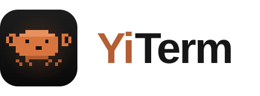
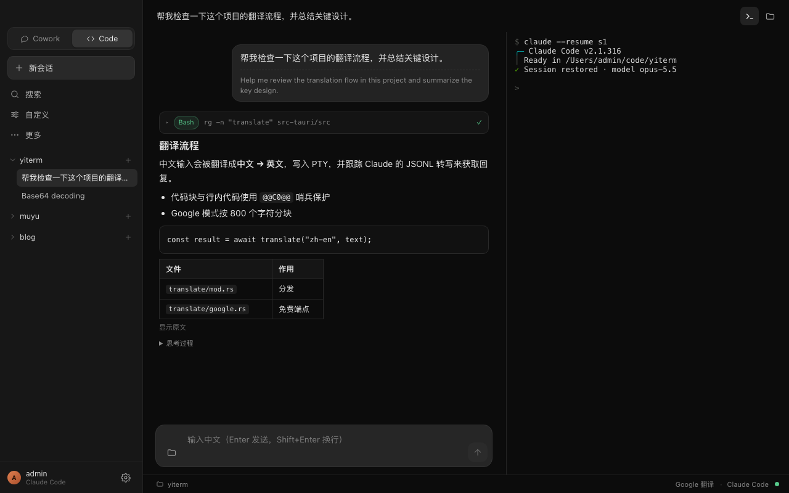

<p align="center">
  <picture>
    <source media="(prefers-color-scheme: dark)" srcset="src/assets/logo.svg">
    <source media="(prefers-color-scheme: light)" srcset="src/assets/logo-light.svg">
    
  </picture>
</p>

<p align="center">
  <strong>Claude Code, in Chinese.</strong><br>
  An unofficial macOS desktop shell for
  <a href="https://github.com/anthropics/claude-code">Claude Code</a> — your Chinese
  is translated to English on the way in, and Claude's English is translated back
  to Chinese on the way out.
</p>

<p align="center">
  
</p>

<p align="center">
  <em>Code mode — translated chat on the left, the real Claude Code PTY on the right.</em>
</p>

## Why YiTerm

Claude Code is a great coding agent, but it works in English and its conversation lives in a terminal and a JSONL transcript. YiTerm wraps the real CLI in a desktop app and turns it into a Chinese-first workflow:

- **Chinese in, English out** — your prompt is translated zh → en before it reaches Claude.
- **English in, Chinese out** — assistant replies are followed from the session transcript and translated back en → zh as they stream in.
- **Automatic both ways** — no copying text into a separate translator: the translation runs behind the composer, and the chat mirrors the real session.
- **English is cheaper** — for the same meaning English uses fewer tokens than Chinese, so the English prompt also keeps Claude's context smaller. Text typed in English is sent as-is, skipping translation entirely.
- **Still the real CLI** — YiTerm runs `claude` in a PTY with your existing login, tools, permissions, and MCP setup. No API proxy, no second Claude client.

## Features

- **Chinese-first chat with Claude Code, fully automatic**
  - Chinese prompt → translated to English → written into the real `claude` PTY
  - English reply → mirrored from the JSONL transcript → translated back to Chinese as it arrives
  - English input is sent as-is (no translation call); English prompts also cost fewer Claude tokens than Chinese for the same content
- **Attachments** — paste screenshots or attach images and files from disk;
  images are sent to Claude as images, other files are referenced by path
- **Streaming translation** zh → en and en → zh
  - Google's free endpoints out of the box; DeepL with an API key (free tier:
    500k chars/month) or the built-in anonymous DeepL channel (no key, no
    self-hosted gateway; rate-limited); built-in presets for SiliconFlow and
    OpenRouter (endpoint and model pre-filled — just paste an API key); or any
    OpenAI-compatible chat API
  - **Fully offline local mode**: Tencent's Hy-MT2-1.8B runs on CPU inside the
    app (no Ollama, no API key). The Q3_K_M model (~907 MB) is downloaded on
    demand from Settings — nothing downloads automatically at launch.
  - Fenced code and inline code are protected with sentinels so they survive translation
- **Real terminal**, powered by `portable-pty` and xterm.js, with backlog replay on reattach
- **Session mirror** from Claude Code's JSONL transcript
  - one collapsible line per agent step, labelled with the tool's description
  - thinking on its own collapsible line
  - tool commands, results, and errors revealed on expand
- **GitHub-flavoured Markdown**: tables, code blocks, lists; links open in the system browser
- **Project-grouped sessions** with search and per-project “new session”
- **Claude Code records in the sidebar** — every project registered in
  `~/.claude.json` plus existing CLI sessions are listed and resumable;
  replayed history is shown as-is, while new replies are still translated
- **Two layouts**: Code (chat + terminal) and Work (chat only)
- **Plan review in chat** — read the full plan and, while Claude Code's approval
  prompt is active, execute with manual approvals or skip permission prompts for
  the current session; open the terminal to request changes
- **Sessions / Git sidebar views** — switch between project-grouped sessions and
  Document Review, with staged and unstaged files and file-type icons; click a file
  to open its diff, with automatic refresh and support for new files, renames,
  deletions, binary files, and merge conflicts
- **Update checks** at launch and every hour while running, with a manual
  **Check for Updates** button in Settings → About
- **Persistence**: conversations, chat history, and translation settings
- **API keys in a local `keys.json`** (one per chat provider)
- **System proxy detection** via `scutil`, so translation works behind a local proxy
- **Plain-text logs** in `~/Library/Logs/com.yiterm.app/`

## How it works

```text
┌────────────────────────────── React ──────────────────────────────┐
│  chat mirror · translation client · xterm.js · project sidebar    │
└───────────────────────────────┬───────────────────────────────────┘
                                │ Tauri IPC / Channels
┌───────────────────────────────▼───────────────────────────────────┐
│                           Rust backend                            │
│  PTY (portable-pty) · JSONL follower · translate (Google/Chat/Local)│
│  settings + API keys · conversation and chat persistence          │
└───────────────────────────────────────────────────────────────────┘
```

1. `terminal_start` spawns `claude --session-id <uuid>` (or `--resume <uuid>` when the transcript already exists) inside a PTY.
2. Chinese text from the composer is translated zh → en and written to the terminal; text containing no Chinese is written as-is.
3. A follower tails `~/.claude/projects/<munged-cwd>/<session-id>.jsonl` and emits parsed messages.
4. Assistant messages are translated en → zh and streamed into the chat panel.
5. Code spans are replaced with `@@C<n>@@` sentinels before translation and restored afterwards.

## Requirements

- macOS 12.3 or later
- Node.js 22+
- Rust 1.90+
- [Claude Code](https://github.com/anthropics/claude-code) installed and authenticated (`claude`)
- Git installed for the Code-mode changes viewer
- Network access to Google Translate endpoints, DeepL, or an OpenAI-compatible
  provider (not needed in local mode once the model has been downloaded from
  Settings)

## Getting started

```bash
git clone git@github.com:Yukuiii/YiTerm.git
cd YiTerm
npm install
npm run tauri dev
```

YiTerm auto-detects `claude` in `~/.local/bin` or on `PATH`. You can point it at another binary in **Settings**.

### Scripts

| Command | What it does |
| --- | --- |
| `npm run tauri dev` | Run the full desktop app with HMR |
| `npm run dev` | Run only the Vite frontend |
| `npm run tauri build` | Build the `.app` / `.dmg` bundle |
| `npm run lint` | Run oxlint |
| `cd src-tauri && cargo test` | Run the Rust unit tests |

## Configuration

- **Translation mode** — Google free endpoints (no key); DeepL (official API
  with a key; free keys end in `:fx` and use the free host; a custom
  `/v2/translate` URL is supported; or the built-in anonymous channel, which
  needs neither a key nor a gateway but is rate-limited); built-in chat presets
  for SiliconFlow / OpenRouter or any OpenAI-compatible Chat API; or the
  embedded Hy-MT2-1.8B model (offline, CPU-only).
  The local model lives in `models/Hy-MT2-1.8B.Q3_K_M.gguf` under the app data
  directory (`~/Library/Application Support/com.yiterm.app` on macOS,
  `%LOCALAPPDATA%\com.yiterm.app` on Windows) and is downloaded from Settings.
- **Target language** — replies are translated to Simplified Chinese (`zh-CN`).
- **API keys** — stored in `keys.json` in the app data directory (mode 0600 on Unix), one per chat provider; never in the repository.
- **App data** — `~/Library/Application Support/com.yiterm.app/`
  - `settings.json`
  - `keys.json` (chat provider API keys, mode 0600)
  - `conversations.json`
  - `chats/<conversation-id>.json`
- **Pasted screenshots** — `~/Library/Caches/com.yiterm.app/images/<conversation-id>/`
  (disposable; macOS may reclaim them, in which case the history shows `（图片）`)
- **Logs** — `~/Library/Logs/com.yiterm.app/yiterm.log`

## Notes and limitations

- YiTerm is **unofficial** and is not affiliated with or endorsed by Anthropic. Claude Code is a product and trademark of Anthropic.
- macOS only for now.
- The chat mirror depends on Claude Code's JSONL transcript format; parser updates may be needed if that format changes.
- Free Google endpoints can be rate-limited or unreachable without a proxy; use a proxy or Chat mode.
- The built-in DeepL free channel talks to DeepL's client endpoint anonymously; it is unofficial, rate-limited, and may stop working when DeepL changes its apps.
- Machine translation is approximate — review important technical text before relying on it.

## Credits

- Terminal typeface: [Ioskeley Mono](https://github.com/ahatem/IoskeleyMono) — SIL Open Font License 1.1 (`src/assets/fonts/OFL.txt`).
- The built-in DeepL free channel follows the anonymous iOS request profile implemented by [DLX](https://github.com/OwO-Network/DLX) (formerly DeepLX) — MIT licensed.

## License

[MIT](LICENSE)
